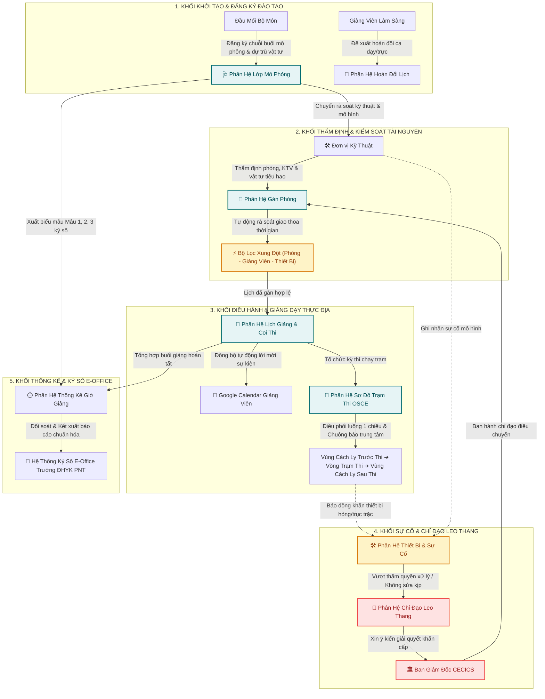

# CECICS WebApp — Hệ Thống Vận Hành Số Hóa Trung Tâm Kỹ Năng & Sáng Tạo Mô Phỏng Lâm Sàng
### Trường Đại học Y khoa Phạm Ngọc Thạch

Hệ thống quản lý, điều phối và vận hành toàn diện các hoạt động đào tạo thực hành mô phỏng lâm sàng, thi chạy trạm OSCE, quản lý trang thiết bị y tế kỹ thuật cao và tự động hóa hồ sơ giảng dạy liên thông hệ thống E-Office của Nhà trường.

---

## I. Sơ Đồ Mối Liên Kết Nghiệp Vụ Giữa Các Phân Hệ (Workflow & Node Connectivity)

Hệ thống vận hành theo quy trình khép kín giữa 6 chủ thể nghiệp vụ: **Ban Giám đốc Trung tâm**, **Đơn vị Hành chính**, **Đơn vị Kỹ thuật & KTV**, **Đầu mối Bộ môn**, **Giảng viên Lâm sàng** và **Sinh viên / Học viên Y khoa**.

---

## II. Danh Mục Các Phân Hệ Chức Năng Cốt Lõi

### 1. 📊 Phân Hệ Tổng Quan Điều Hành (Executive Dashboard)
- Trung tâm giám sát thời gian thực toàn bộ hoạt động đào tạo tại 2 cơ sở (Cơ sở Hòa Hưng & Cơ sở Tân Nhật).
- Cung cấp các chỉ số vận hành quan trọng: Tổng số buổi giảng trong tuần, tỷ lệ lấp đầy phòng mô phỏng, số lượng lớp đang chờ thẩm định, số ca sự cố thiết bị cần xử lý và cảnh báo các ca chưa được phân bổ phòng trước ngày diễn ra.

### 2. 📅 Phân Hệ Lịch Giảng & Lịch Coi Thi (Master Clinical Schedule)
- Quản lý lịch tập trung toàn diện theo chế độ xem Tháng, Tuần, Ngày và Danh sách.
- Phân biệt trực quan bằng màu sắc chuẩn y khoa giữa các hoạt động: Giảng thực hành tiền lâm sàng, huấn luyện mô phỏng bệnh nhân ảo, thi chạy trạm OSCE và họp chuyên môn.
- Tự động tích hợp lịch cá nhân của giảng viên về ứng dụng Google Calendar trên điện thoại thông qua tài khoản thư điện tử công vụ của Nhà trường.

### 3. 🚪 Phân Hệ Gán Phòng & Phân Bổ Giảng Đường (Intelligent Room Assignment)
- Hàng chờ gán phòng thông minh với cơ chế cảnh báo đổi màu theo mức độ khẩn cấp (buổi học còn dưới 2 ngày chưa có phòng sẽ bật cảnh báo đỏ ưu tiên).
- Gợi ý phòng tối ưu dựa trên quy mô học viên, tính chất bài học (Phòng Hồi sức cấp cứu, Skills Lab cơ bản, Phòng Sản - Nhi, Giảng đường lý thuyết).
- Hỗ trợ tính năng gán đa phòng cho các buổi học thực hành chạy trạm hoặc kỳ thi liên trạm.

### 4. 🔄 Phân Hệ Hoán Đổi Lịch Giảng (Peer Shift Swapping)
- Cho phép các giảng viên chủ động gửi đề nghị hoán đổi ca giảng hoặc nhờ đồng nghiệp dạy thay khi có lịch công tác đột xuất, lịch mổ cấp cứu hoặc trực viện.
- Cơ chế phản hồi minh bạch: Bắt buộc cung cấp lý do lâm sàng khi từ chối đề xuất (kèm các nút gợi ý nhanh: *Trùng lịch mổ, Trực cấp cứu, Đi công tác*), lưu vết lịch sử phục vụ thanh tra đào tạo.

### 5. 🩺 Phân Hệ Lớp Mô Phỏng & Dự Trù Vật Tư (Sim Classes & Multi-Session Series)
- **Đăng ký theo chuỗi nhiều buổi (Lịch định kỳ)**: Cho phép Bộ môn tạo khóa đào tạo lặp lại định kỳ vào các ngày cố định trong tuần với thời gian bắt đầu và kết thúc thống nhất, kèm bảng tùy biến chi tiết từng buổi học lẻ.
- **Bảng dự trù vật tư tiêu hao tự động**: Tính toán cơ số vật tư tiêu hao chuẩn xác theo công thức định mức Y khoa `Tổng nhu cầu = Định mức/nhóm × Số nhóm × Số buổi thực hành`.
- **Thẩm định kỹ thuật 2 cấp**: Đơn vị Kỹ thuật phân bổ phòng thực hành và Kỹ thuật viên phụ trách chung cho cả khóa hoặc ghi đè riêng từng buổi học đặc thù.
- **Biểu mẫu hành chính E-Office chuẩn hóa**: Tự động kết xuất Giấy đề xuất mở lớp, Bảng dự trù vật tư - thiết bị và Bảng thẩm định cơ sở vật chất (Mẫu 1, 2, 3) theo đúng thể thức văn bản hành chính Nhà nước (Quốc hiệu, Tiêu ngữ, bảng biểu kẻ lưới, chữ ký Trưởng Bộ môn và Trưởng Trung tâm) sẵn sàng ký số.

### 6. 🧭 Phân Hệ Sơ Đồ Trực Quan Trạm Thi OSCE (OSCE Circuit & Live Floor Plan)
- **Mặt bằng trạm thi khép kín**: Trực quan hóa mặt bằng 8 trạm tại Cơ sở Hòa Hưng và 12 trạm tại Cơ sở Tân Nhật.
- **Bảo mật luồng di chuyển một chiều**: Phân định nghiêm ngặt 3 phân khu:
  - *Phòng Chờ Trước Thi (Holding Room A)*: Vùng cách ly cấp 1, thu giữ thiết bị liên lạc, điểm danh danh sách thí sinh hàng chờ.
  - *Vòng Trạm Thi Lâm Sàng*: Thể hiện số trạm, mã phòng, tên kỹ năng, giảng viên chấm thi, thí sinh đang thi, đèn báo Camera giám sát trực tiếp và mũi tên chỉ dẫn di chuyển một chiều giữa các trạm chống rò rỉ đề thi.
  - *Phòng Cách Ly Sau Thi (Holding Room B)*: Lưu giữ thí sinh đã hoàn thành toàn bộ vòng thi cho đến khi kết thúc ca thi.
- **Đồng hồ đếm ngược trung tâm & Chuông báo âm thanh tự nhiên**:
  - Chuông cảnh báo 1 phút cuối trạm nhắc nhở thí sinh hoàn thiện bài thi.
  - Chuông hết giờ báo chuyển trạm và tự động luân chuyển thí sinh giữa các trạm trong mạch thi.
- **Bảng kiểm kỹ năng lâm sàng (Checklist)**: Quản lý thang điểm 10.0 chi tiết từng tiêu chí thao tác lâm sàng và tích hợp nút báo động sự cố kỹ thuật khẩn cấp tại trạm.

### 7. 🛠️ Phân Hệ Thiết Bị & Sự Cố Mô Hình (Equipment & Incident Management)
- Quản lý danh mục mô hình giải phẫu, mô hình mô phỏng tuần hoàn - hô hấp thông minh (SimMan, Resusci Anne QCPR, Harvey, Lucina) và máy móc thiết bị y tế (Máy sốc điện khử rung tim ngoài, Đèn soi thanh quản, Máy theo dõi bệnh nhân).
- Tiếp nhận và theo dõi tiến độ khắc phục sự cố hư hỏng đột xuất từ các phòng học và trạm thi OSCE; đánh giá khả năng sửa chữa kịp giờ học hay cần điều chuyển thiết bị dự phòng.

### 8. 🚨 Phân Hệ Điều Phối & Chỉ Đạo Leo Thang (Leadership Escalation Hub)
- Kênh giải quyết các tình huống phát sinh vượt thẩm quyền của chuyên viên hành chính hoặc kỹ thuật viên (mô hình đặc chủng hỏng nặng trước ca thi tốt nghiệp, xung đột phòng học giữa hai Bộ môn lớn, lớp học xin mở gấp ngoài kế hoạch).
- Nơi Ban Giám đốc Trung tâm xem xét bối cảnh lâm sàng, đưa ra chỉ đạo điều chuyển hoặc phê duyệt phương án dự phòng.

### 9. 🎓 Phân Hệ Đào Tạo Y Khoa Liên Tục (CME Lifelong Learning Hub)
- **Cổng tuyển sinh trực tuyến**: Hỗ trợ đăng ký khóa học, thông báo chỉ tiêu, học phí và hướng dẫn chuyển khoản.
- **Tái sử dụng hồ sơ học viên cũ thông minh**: Tự động tra cứu qua Số CCCD và Ngày sinh để tự động điền lại toàn bộ thông tin cá nhân, đơn vị công tác, email, chức danh và hồ sơ văn bằng cũ, giúp học viên không phải khai báo lại.
- **Quy trình đào tạo khép kín**: Xác nhận học phí $\rightarrow$ Thông báo nhập học & đồng bộ Google Calendar $\rightarrow$ Làm bài Pre-test $\rightarrow$ Điểm danh từng buổi $\rightarrow$ Làm bài Post-test & Lượng giá kỹ năng lâm sàng $\rightarrow$ Khảo sát chất lượng khóa học $\rightarrow$ Cấp chứng chỉ CME & Lập bảng nghiệm thu - giải chi tài chính.
- **Nạp dữ liệu khóa cũ (Legacy Import)**: Tiếp nhận lịch sử các khóa đào tạo, danh sách học viên cũ và mã chứng chỉ đã cấp trước đây vào hệ thống dữ liệu tập trung.

### 10. ⏱️ Phân Hệ Thống Kê & Đối Soát Giờ Giảng (Faculty Hours & Audit)
- Thống kê chi tiết khối lượng giờ giảng thực tế của từng cán bộ, giảng viên cơ hữu và giảng viên thỉnh giảng theo từng Bộ môn, hệ đào tạo và học phần.
- Công cụ đối soát giờ giảng tự động giữa kế hoạch đào tạo ban đầu và dữ liệu giảng dạy thực tế phục vụ công tác thanh toán phụ cấp thù lao giảng dạy và báo cáo quyết toán năm học.

### 11. ⚙️ Phân Hệ Quản Trị Danh Mục Dùng Chung (System Administration)
- Phân quyền theo vai trò chặt chẽ: Ban Giám đốc, Đơn vị Hành chính, Đơn vị Kỹ thuật, Đầu mối Bộ môn, Giảng viên.
- Quản lý danh mục cơ sở đào tạo, danh mục phòng học, danh mục Bộ môn và tài khoản người dùng công vụ trong toàn Trường.

---

## III. Quy Chuẩn Vận Hành Nghiệp Vụ Lâm Sàng

1. **Chuẩn Định Dạng Thời Gian & Lịch Biểu**:
   - Định dạng ngày thống nhất: `dd/mm/yyyy` (Ví dụ: `24/11/2026`).
   - Định dạng giờ thống nhất: `hh:mm` 24 giờ (Ví dụ: `08:00`, `14:30`).
   - Thứ 2 (`T2`) luôn là ngày đầu tuần làm việc; Thứ 7 (`T7`) và Chủ Nhật (`CN`) là ngày cuối tuần trên toàn bộ bảng biểu, lịch công tác và báo cáo.

2. **Quy Tắc Chống Trùng Lặp & Giao Thoa Phòng Học**:
   - Hệ thống tự động kiểm tra khoảng thời gian giao thoa theo điều kiện `(Giờ bắt đầu A < Giờ kết thúc B) VÀ (Giờ kết thúc A > Giờ bắt đầu B)` trên cùng một phòng học hoặc cùng một thiết bị mô phỏng để ngăn chặn tuyệt đối tình trạng hai lớp trùng phòng.

3. **Bảo Mật Y Tế & Ký Số E-Office**:
   - Dữ liệu giảng dạy, hồ sơ học tập và biểu mẫu đề xuất vật tư được chuẩn hóa theo quy định hành chính của Trường Đại học Y khoa Phạm Ngọc Thạch, đảm bảo tính pháp lý khi chuyển giao lưu trữ và ký số điện tử trên hệ thống E-Office của Nhà trường.
